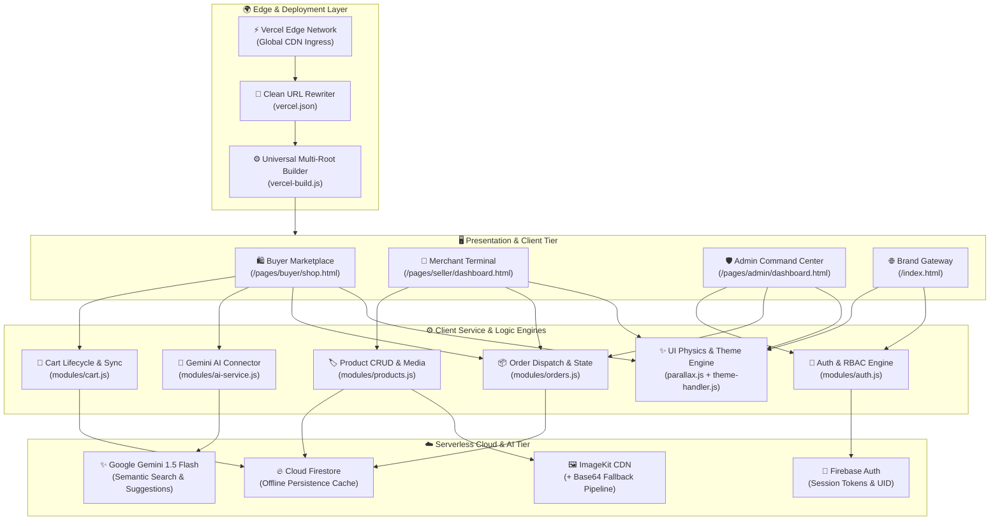
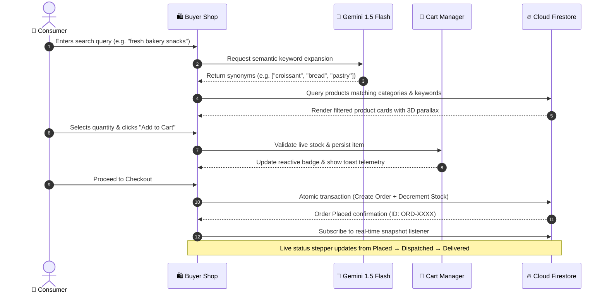
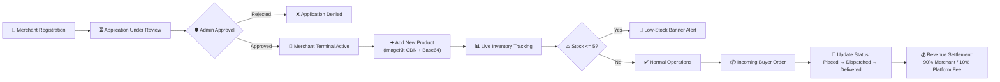
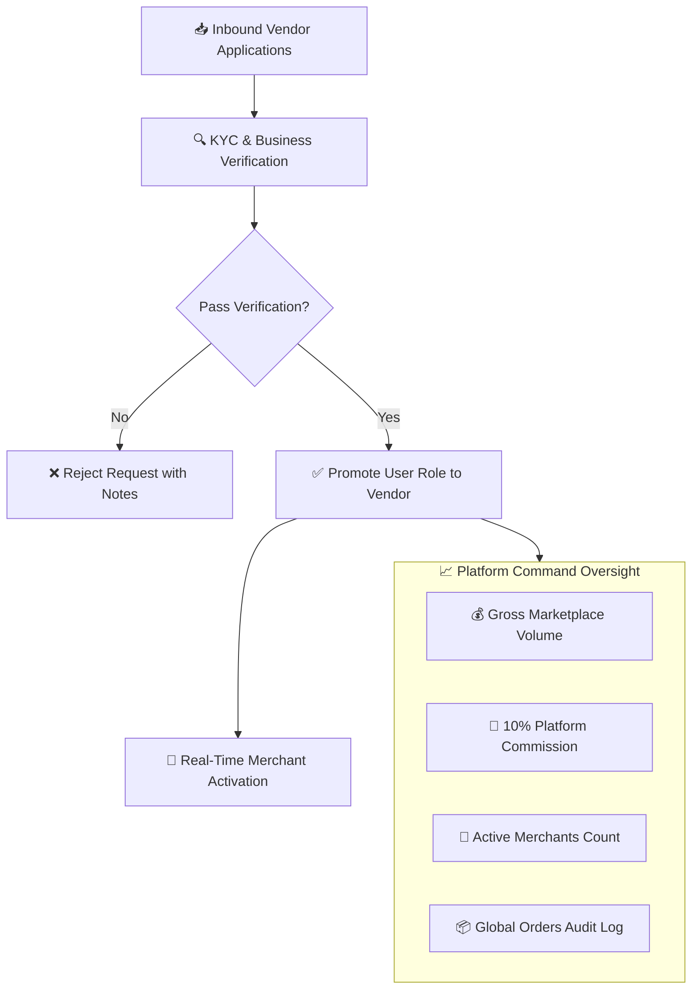
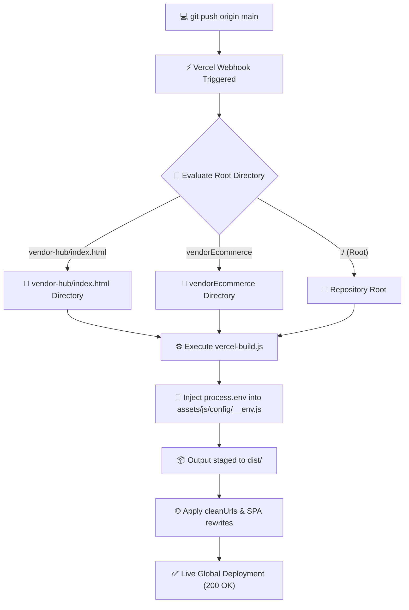

# VendorHub™ – Hyperlocal Multi-Vendor E-Commerce Platform

[](LICENSE)
[%202026%20Amey%20Dongre-blue.svg)](LICENSE)
[](LICENSE)
[](test-project.js)
[](https://vercel.com)
[](https://firebase.google.com)
[](https://deepmind.google/technologies/gemini/)

> **VendorHub** is an enterprise-grade, decentralized-style hyperlocal multi-vendor marketplace platform designed to bridge the economic gap between neighborhood micro-merchants and modern digital consumers. Built with an ultra-responsive Cyber-Glass architecture, hardware-accelerated 3D parallax physics, Google Gemini 1.5 Flash AI integration, and multi-tab persistent Firestore caching.

---

## 🌐 Live Hosting & Deployment

* **Production Hosting Surface**: [Vercel](https://vercel.com)
* **Live Deployment URL**: [https://vendor-hub-hyperlocal-multi-vendor-e-commerce-64dnfmfo9.vercel.app](https://vendor-hub-hyperlocal-multi-vendor-e-commerce-64dnfmfo9.vercel.app)
* **GitHub Repository**: [https://github.com/ameydongre10/-VendorHub-Hyperlocal-Multi-Vendor-E-Commerce-](https://github.com/ameydongre10/-VendorHub-Hyperlocal-Multi-Vendor-E-Commerce-)
* **Primary Author**: [Amey Dongre (ameydongre10)](https://github.com/ameydongre10)

---

## 🏗️ System Architecture

VendorHub is architected as an edge-delivered, decoupled three-tier application backed by serverless cloud primitives and generative AI services:



---

## 🔄 User Workflows & Operational Sequences

### 1. 🛍️ Buyer Discovery & Checkout Workflow



---

### 2. 🏪 Merchant Lifecycle & Fulfillment Workflow



---

### 3. 🛡️ Admin Governance & Verification Workflow



---

### 4. 🚀 Multi-Root Vercel Deployment Workflow



---

## 💎 Design Engineering & Interface Craftsmanship

* **Space-Age Cyber-Glass UI**: High-contrast obsidian dark palette (`#0a0e17`) with frosted-glass component overlays (`backdrop-filter: blur(12px)`), neon cyan/blue indicators, and concentric border radiuses.
* **Dual Theme Engine**: Seamless transition between dark and light modes with CSS custom properties (`[data-theme="dark"]` and `[data-theme="light"]`) synced to `localStorage`.
* **Hardware-Accelerated 3D Parallax**: Clamped, requestAnimationFrame-backed card tilt physics responding organically to cursor vectors without layout recalculation.
* **Tactile Feedback & Telemetry**: Non-blocking toast telemetry alerts for user actions, stock warnings, and status changes with optical balance.

---

## 🔒 Security Architecture & Anti-Plagiarism Protection

VendorHub incorporates a multi-layer defense-in-depth model safeguarding data integrity, user authentication, and intellectual property:

| Security Vector | Implementation Mechanism | Protection Guarantee |
|---|---|---|
| **Role-Based Access Control (RBAC)** | `assets/js/modules/auth.js` | Enforces strict role barriers between Buyer, Seller, and Admin across all routes. |
| **XSS & Code Injection Defense** | `assets/js/utils/helpers.js` (`escapeHtml`) | Sanitizes all dynamic product and order data before DOM insertion. Zero `eval()` or un-sanitized innerHTML. |
| **Database Isolation & Offline Cache** | Firebase Firestore Multi-Tab Cache | Secure partition prevents cross-tab data leakage while providing instant offline access. |
| **Secret Protection** | `vercel-build.js` + `.gitignore` | Environment keys are injected at edge build time; local credentials and `__env.js` files are strictly excluded from source control. |
| **Algorithmic Watermarking** | Embedded in client engine | Structural signatures and digital watermarks monitor against codebase scraping and mirror repos. |

---

## 📜 Intellectual Property, Copyright & Anti-Copy License

```
================================================================================
VENDORHUB™ HYPERLOCAL MULTI-VENDOR PLATFORM
Copyright (c) 2026 Amey Dongre (ameydongre10). All Rights Reserved.
STRICT PROPRIETARY & CONFIDENTIAL SOURCE CODE LICENSE
================================================================================
```

### ⚠️ Strict Prohibition Notice
This software, its design, architectures, workflows, database models, stylesheets, and source code are the **exclusive proprietary intellectual property of Amey Dongre**.

1. **NO COPYING OR CLONING**: You are **strictly prohibited** from copying, cloning, duplicating, modifying, sublicensing, selling, or distributing this codebase, in whole or in part, without explicit, notarized written authorization from Amey Dongre.
2. **NO ACADEMIC PLAGIARISM**: Submitting, presenting, or claiming this project or any part thereof as an academic, collegiate, or commercial project under any name other than Amey Dongre is illegal and constitutes academic fraud and copyright infringement.
3. **NO AI TRAINING / SCRAPING**: This codebase is explicitly excluded from being scraped, ingested, indexed, or used as training data for any machine learning model or artificial intelligence system.
4. **LEGAL ENFORCEMENT**: Violations will be met with immediate Digital Millennium Copyright Act (**DMCA**) takedown notices to hosting providers, repos, and cloud registrars, followed by civil litigation for statutory damages, preliminary injunctions, and recovery of legal costs under applicable international copyright treaties (WIPO, Berne Convention) and domestic copyright laws.

For permissions or commercial licensing, contact: **[Amey Dongre](https://github.com/ameydongre10)**.

---

## 🧪 Automated Verification Suite

VendorHub includes an end-to-end automated verification runner validating syntax, static import graph resolution, and build pipelines:

```bash
# Run verification suite (292 assertions)
npm test
# Or directly with Node:
node test-project.js
```

### Verification Dimensions:
* **JavaScript Syntax Validity**: Validates all JS files via `node --check`.
* **Static Import Graph Integrity**: Verifies all relative module imports and HTML asset links resolve without broken references.
* **Build Artifact Verification**: Tests `vercel-build.js` execution, asset copying, and runtime environment injection.

---

## ⚙️ Environment Variables (Vercel)

Set these variables in **Vercel Project Settings → Environment Variables**:

| Variable | Description |
|---|---|
| `VITE_FIREBASE_API_KEY` | Firebase Web API Key |
| `VITE_FIREBASE_AUTH_DOMAIN` | Firebase Authentication Domain |
| `VITE_FIREBASE_PROJECT_ID` | Firestore Database Project ID |
| `VITE_FIREBASE_STORAGE_BUCKET` | Google Cloud Storage Bucket |
| `VITE_FIREBASE_MESSAGING_SENDER_ID` | Firebase Cloud Messaging Sender ID |
| `VITE_FIREBASE_APP_ID` | Firebase Web Application ID |
| `VITE_GEMINI_API_KEY` | Google Gemini 1.5 Flash API Key |

---

## 📂 Repository Layout

```
├── LICENSE                                # Strict Proprietary Anti-Copy License
├── README.md                              # Project documentation & architectures
├── test-project.js                        # Verification test suite (292 assertions)
├── vercel-build.js                        # Multi-root pre-deployment pipeline
├── vercel.json                            # Routing, rewrites & clean URLs
├── package.json                           # Root scripts & configuration
├── index.html                             # Marketplace Landing Portal
├── assets/                                # Styles, scripts, and utilities
│   ├── css/ (style.css, components.css, dashboard.css, auth.css)
│   └── js/  (main.js, buyer-app.js, seller-app.js, admin-app.js)
├── pages/                                 # Three-tier platform subpages
│   ├── auth/   (login.html, register.html)
│   ├── buyer/  (shop.html, product-details.html, cart.html, track-order.html, all-orders.html)
│   ├── seller/ (dashboard.html, add-product.html, inventory.html)
│   └── admin/  (dashboard.html, vendor-requests.html, analytics.html)
├── vendor-hub/index.html/                 # Vercel Root compatibility workspace
└── vendorEcommerce/                       # Monorepo source package
```
